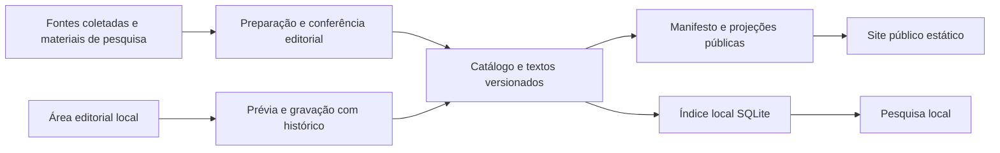

# Arquitetura editorial e de experiência

Data: 19 de outubro de 2026. Estado: proposta de arquitetura, com decisões do responsável registradas abaixo. Não constitui implementação nem aprovação de todas as entregas futuras.

## 1. Missão e limites

ShowTrials é um projeto de pesquisa histórica, preservação, organização e edição digital crítica de fontes sobre a história política soviética, especialmente as disputas partidárias e os processos político-judiciais dos anos 1930.

- **ShowTrials Discovery:** infraestrutura de pesquisa e bastidores; coleta, inventários, classificação, nomes, proveniência, relações, glossários e preparação editorial.
- **Documentos Soviéticos:** edição pública; coleções, busca, leitura, traduções, comparação e instrumentos de consulta e citação.

São dimensões complementares do mesmo acervo, não dois catálogos concorrentes. Sua separação conceitual não implica criar agora dois serviços, dois repositórios ou outra plataforma. A interface pública serve ao iniciante e ao especialista; o ambiente local acrescenta ferramentas do pesquisador-editor.

Referências: [conceito fornecido pelo responsável](../../temporario/SHOWTRIALS_CONCEITO_EDITORIAL_UX.md), suas orientações na conversa e [interface atual](INTERFACE-ARQUIVO.md). O documento temporário é contexto de visão; não foi tratado como relatório das funções implementadas.

## 2. Decisões confirmadas nesta conversa

| Questão | Decisão |
| --- | --- |
| Entrada pública | Coleções e busca com destaque equivalente. |
| Traduções | Publicar versões de trabalho, distinguindo as revisadas. |
| Pesquisa transversal | Pessoas e episódios têm importância equivalente; não escolher apenas um deles. |
| Relações | Registrar o que a fonte afirma, quem o afirma e a passagem de apoio. Avaliação histórica em nota editorial separada. |
| Idioma inicial | Português quando disponível; lembrar a escolha na sessão. |

As decisões seguintes são propostas técnicas/editoriais reversíveis, ainda sujeitas à avaliação do responsável. Nenhum registro legado recebe automaticamente uma avaliação de revisão.

## 3. O que a base atual já oferece

Inspeção do código e da documentação, sem executar testes:

- Catálogo versionado com documentos, edições por idioma, coleções, subcoleções e associações ordenadas. IDs ShowTrials não equivalem a cotas arquivísticas.
- Um documento pode pertencer a mais de uma coleção sem copiar seu texto. O manifesto é uma projeção de compatibilidade do catálogo.
- Leitor com Markdown, estudo por parágrafo ou em paralelo, índice, marcador, retomada na sessão, exportação e navegação contextual.
- Backend Python local com busca SQLite FTS5, cadastro, edição de metadados e Markdown, importação de traduções, correções de trechos, prévia e histórico recuperável.
- Site estático com busca nos títulos. Não há hoje equivalência entre essa busca e a busca local no texto completo.
- Ainda faltam entidades operacionais de pessoas/variantes, episódios e relações documentadas, alinhamento persistente de trechos e publicação editorial assistida.

As quantidades presentes em documentos antigos de planejamento são registros históricos, não números atuais do acervo.

## 4. Mapa de informação proposto

```text
Documentos Soviéticos
├── Início: apresentação breve + busca + coleções
├── Coleções
│   └── Coleção → subcoleção → documento
├── Busca no acervo
│   └── Resultados → documento, mantendo consulta e página
├── Pesquisa [ampliação futura]
│   ├── Pessoas → ficha → documentos e episódios
│   └── Episódios → apresentação → fontes e pessoas
├── Sobre o acervo
│   ├── Projeto, recorte e organização
│   ├── Fontes, proveniência e critérios editoriais
│   └── Traduções, revisão e como citar
└── Área editorial [somente com backend local]
    ├── Revisão: fila e histórico
    ├── Acervo: catálogo, coleções, cadastro e importação
    ├── Textos: versões, traduções e editor Markdown
    └── Pesquisa: entidades e vínculos [ampliação futura]
```

“Pesquisa” reúne pessoas e episódios sob uma entrada comum para não lotar a navegação superior. A busca continua acessível em todas as áreas e permitirá futuramente encontrar essas entidades. Não exibir seções vazias como funções prontas.

## 5. Composição e navegação

### Estrutura comum

Cabeçalho compacto: marca, Coleções, Buscar, Pesquisa quando disponível e Sobre. Área editorial aparece quando o backend local confirma capacidade. Nenhum menu superior enumera todas as coleções.

No desktop, navegação contextual lateral retrátil; centro amplo dedicado à tarefa; painel auxiliar opcional. No celular, navegação e informações auxiliares em painéis que abrem por solicitação, com retorno de foco ao controle de origem. A leitura mantém uma coluna confortável, sem barras laterais permanentes.

A referência ao Replit orienta hierarquia, painéis e consistência. Não determina tema escuro, terminal, múltiplas abas ou aparência de ferramenta de programação. Abas de vários documentos ficam para avaliação posterior; histórico do navegador e links continuam suficientes para a primeira versão.

Separar três funções: navegação global (onde estou no site), navegação contextual (onde estou no conjunto) e ações do documento (o que posso fazer). Não repetir todos os comandos nas três áreas.

### Início

- Apresentação curta: o que há no acervo e para quem ele serve; acesso aos critérios editoriais.
- Busca e acesso às coleções na primeira área visível, com importância equivalente.
- Coleções com capa, título, recorte e acesso claro; alternância Capas/Lista preservada.
- Pessoas e episódios ganham uma entrada quando houver conteúdo editorial suficiente.
- Contagens, se mantidas, são auxiliares; não lideram a página. Evitar chamadas genéricas que ocupem a tela sem ajudar a localizar fontes.

### Coleção e subcoleção

- Caminho de navegação, título, recorte e introdução breve; apresentação longa pode ser expandida.
- Subcoleções com descrição do critério de agrupamento, ordem explícita e lista paginada.
- Cada linha: título e data juntos; abaixo, tipo documental, idiomas e informação editorial relevante. Dados desconhecidos não são inventados.
- Ordem editorial como padrão do conjunto; outras ordenações explícitas, sem regravar a ordem cadastrada.
- Filtro rápido dentro do conjunto e acesso à busca já filtrada pela coleção.
- Um mesmo documento pode ocorrer em conjuntos diferentes; a interface conserva o contexto de entrada.

### Documento

```text
Cabeçalho global
Caminho de origem / voltar à lista ou aos resultados
Painel compacto: ferramentas, retomar, baixar, editar quando local
Título + data + identificação breve
Texto / texto em paralelo
Documento anterior e próximo no conjunto de origem
```

A lateral contextual pode conter a árvore da coleção e sua posição; abre sob demanda e não duplica uma segunda lista permanente no centro. Índice e ficha documental são painéis auxiliares do leitor. Apenas um painel auxiliar por vez no celular; no desktop, permitir navegação lateral e um auxiliar sem reduzir excessivamente o texto.

- Manter o painel de controle antes do cabeçalho do documento, recolhido inicialmente, com fixação opcional e retomada visível quando houver marcador.
- Leitura: um idioma em fluxo contínuo. Estudo: ferramentas de comparação e correção local, por parágrafo ou paralelo. Alternar sem recarregar a página e preservando posição reconhecível.
- Português na primeira abertura quando disponível. Escolha explícita no link ou feita pelo leitor prevalece; lembrar na sessão. Se o idioma preferido não existir, usar a edição original identificada, ou a versão disponível segundo regra explícita; não alterar a preferência global silenciosamente.
- Baixar e Editar usam por padrão o idioma lido ou a coluna esquerda no paralelo; escolha alternativa em um seletor consistente. Importação exige confirmação explícita de documento e idioma.
- Ficha documental: ID, títulos, data histórica, tipo, origem, referência, idiomas e estados editoriais, conforme disponibilidade. Data de publicação na fonte externa é campo distinto, sem avisos repetidos na lista.
- “Como citar”: referência bibliográfica da reprodução/edição e link estável, com idioma e procedência. ID local aparece como identificador, não como referência de arquivo. Citação por parágrafo só após estabilizar âncoras de passagens.
- Anterior/próximo apenas no fim do documento e conforme a coleção/subcoleção de origem. Se não houver contexto, não inventar sequência. Voltar à busca permanece uma ação distinta.
- Notas da fonte, notas da tradução e notas editoriais devem ser distinguíveis sem alterar silenciosamente notas legadas cuja autoria é desconhecida.

## 6. Pesquisa transversal: pessoas e episódios juntos

### Pessoas

Ficha com nome de exibição, grafias russas, transliterações/variantes, breve identificação editorial e fontes dessa identificação. Listar documentos em que há vínculos cadastrados e episódios relacionados, com filtros por coleção, data, idioma e natureza do vínculo.

Uma ocorrência textual não basta para unir homônimos. Importar variantes dos materiais de pesquisa como candidatos; confirmação editorial antes da associação. Busca por variante reconhecida leva à pessoa e aos documentos vinculados; não promete tradução automática de consultas nem resolução de flexões russas.

### Episódios

Unidade editorial de investigação que pode atravessar coleções: delimitação, datas quando conhecidas, descrição e fontes reunidas. Não coincide obrigatoriamente com processo judicial ou coleção. Sua ordem pode ser cronológica ou editorial, sempre declarada; datas incertas não são convertidas em dias exatos.

Página com apresentação, sequência documental, pessoas e links para coleções. Uma cronologia documentada pode vir depois da lista; um grafo não é condição para pesquisar relações.

### Relações sustentadas por fontes

Cada vínculo proposto deve conter:

- Sujeito, tipo de relação e objeto, com IDs estáveis.
- Documento e edição de apoio; passagem identificada e pequeno excerto de conferência quando necessário.
- Atribuidor: pessoa que fala, órgão emissor ou voz da fonte, conforme o caso.
- Natureza: afirmação da fonte, vínculo catalográfico ou associação editorial; não misturar esses planos.
- Nota editorial separada, autoria/responsável quando conhecido, data de registro e histórico.
- Estado de conferência editorial do vínculo; isso não mede a veracidade histórica da alegação.

Exemplo de apresentação: “No depoimento X, A afirma ter encontrado B”, com acesso à passagem. Não transformar esse registro numa afirmação categórica “A encontrou B”. Uma associação editorial a um episódio informa seu critério; não precisa fingir que foi declarada pela fonte.

Pessoas e episódios compartilham o modelo de vínculos. Construir um piloto conjunto, em vez de terminar uma área inteira antes de começar a outra.

## 7. Busca como instrumento comum

Uma entrada de consulta, com filtros progressivos. Mostrar claramente o alcance disponível: títulos no site atual; títulos e texto completo no backend. Tipos de resultados futuros: documentos, pessoas e episódios, em grupos identificados.

Resultados documentais únicos, com título/data, coleção pertinente, idiomas e trecho/idioma da correspondência quando houver. Filtrar por idioma significa procurar na versão desse idioma, não traduzir as palavras digitadas. Preservar consulta, filtros, ordenação e página ao abrir e voltar.

Próxima evolução pública recomendada: índice estático derivado do catálogo, primeiro para metadados e, em etapa posterior, texto completo dividido em partes carregadas sob demanda. Antes de escolher biblioteca e divisão, medir tamanho do corpus e custo em celulares numa entrega autorizada. Nenhuma promessa de desempenho ou de paridade com FTS5 nesta proposta.

Entidades e variantes confirmadas alimentam o índice. Não depender de um backend público para oferecer essas projeções de leitura. Busca remota continua uma alternativa futura, não requisito para a arquitetura inicial.

## 8. Área editorial e ciclo de publicação

Percurso principal:

```text
Localizar documento ou criar cadastro
→ abrir ficha e versão
→ importar/editar/traduzir
→ conferir prévia, diferenças e diagnóstico estrutural
→ confirmar gravação local com histórico
→ voltar ao leitor no mesmo contexto
→ conferir alterações destinadas à publicação
→ commit e push autorizados separadamente
→ publicação estática
```

Organizar a edição por documento: Visão geral e metadados; Versões e traduções; Coleções; futuramente Pessoas e episódios; Histórico. A navegação global editorial continua oferecendo fila, catálogo e criação/importação. Documento e idioma ativos permanecem visíveis.

A fila agrega pendências com prioridade, motivo e acesso à ação correspondente. Separar falha de conversão, revisão da tradução, metadado incompleto e vínculo por conferir. Resolver uma não marca as demais como concluídas. Não usar um único selo de “qualidade” para resumir todo o documento.

Traduções: propor estados por edição “Revisão não registrada”, “Tradução de trabalho”, “Em revisão” e “Revisada”, com nota de escopo e registro de revisão. A política detalhada de revisão ainda precisa ser definida. Edições legadas permanecem sem avaliação registrada até classificação explícita; não rebaixar nem certificar traduções por inferência. Uma alteração textual posterior precisa sinalizar revisão pendente da nova versão, preservando a revisão anterior no histórico.

Uma futura tela de preparação de publicação mostra o conjunto de mudanças locais e pendências bloqueantes; não realiza publicação automática. Histórico editorial e Git têm funções complementares. O histórico local atual em `.local/` não é publicado pelo Git; política de cópias e preservação precisa ser estabelecida antes de depender dele como único registro recuperável.

## 9. Modelo de informação e arquitetura técnica

| Unidade | Papel e tratamento |
| --- | --- |
| Documento | Identidade estável, títulos, tipo, datas, referências e proveniência. Preservar IDs e URLs. |
| Edição | Texto por idioma, arquivo/formato, hash, origem da tradução e estado de revisão. |
| Coleção/subcoleção | Organização editorial com associações ordenadas; sem duplicar textos. Manter os dois níveis atuais nesta fase. |
| Pessoa/variante | Nova entidade confirmada editorialmente; candidatos da pesquisa ficam separados. |
| Episódio | Nova entidade editorial transversal, com recorte e referências. |
| Passagem | Futuro identificador estável de trecho, ligado a edição e versão; não confundir com número transitório do parágrafo. |
| Vínculo | Relação tipada, atribuída, sustentada e revisável. |
| Revisão/operação | Quem alterou quando, motivo e versão afetada, conforme dados disponíveis; separar histórico interno da informação pública. |



JSONs do catálogo e arquivos textuais continuam como fontes de verdade existentes; SQLite é derivado. Novas entidades exigem evolução explícita de esquema, validação, projeções e histórico — não guardar dados centrais apenas em um índice. As fontes brutas preservadas permanecem distintas do Markdown preparado e das traduções. Nem todo material de trabalho vai para a publicação.

Não implementar vínculos permanentes com base apenas na posição dos parágrafos atuais. Antes disso, definir IDs de passagens e detecção de desatualização: conservar a referência à versão e pedir reconferência se o trecho mudar. Índice de títulos Markdown e marcadores de sessão podem continuar usando sua lógica atual enquanto esse modelo não existe. Correspondência entre idiomas permanece independente: sem alinhamento confirmado, não afirmar equivalência exata de passagens.

Separar componentes de navegação, listagem, ficha, leitor, painéis e formulários; compartilhar identidade visual e regras de contexto. HTML/CSS/JavaScript e Python atuais atendem à primeira etapa. Framework não é pré-requisito; uma migração só se justifica por problema concreto, não pela aparência desejada.

Publicação estática lê projeções e textos; backend local administra gravações. Salvar localmente não modifica o github.io. No futuro, hospedar edição remota exigirá outra entrega, com autenticação, armazenamento e recuperação próprios; não expor o backend local atual diretamente.

## 10. Sistema visual e comportamento

- Paleta em aberto: avaliar duas ou três direções com as mesmas telas e conteúdo real, sem escolher pela capa isolada. Tema claro confortável como ponto de partida; tema escuro não é prioridade definida.
- Tokens compartilhados para superfícies, texto, ação, seleção, foco e estados. Cores não substituem rótulos e ícones; evitar dar sentidos conflitantes à mesma cor.
- Uma família de botões, menus suaves, campos, abas e painéis; distinguir navegação, ação primária e ação secundária. Alturas e espaçamentos consistentes.
- Tipografia de ferramentas compacta; tipografia de leitura escolhida por conforto com português, inglês e cirílico. A escolha atual pode ser mantida durante os protótipos.
- Capas preservadas sem corte; não devem consumir a área principal do trabalho documental.
- Teclado, foco visível, nomes acessíveis, contraste e redução de movimento fazem parte dos critérios de aceite. Nenhum menu depende apenas de hover.
- Estados previstos por tela: carregando, vazio, erro, sem idioma solicitado, edição local indisponível, alterações não salvas e conflito de versão.
- URL guarda documento e contexto compartilhável; sessão guarda preferências, painéis e retomada. Não prometer sincronização entre dispositivos ou armazenamento permanente da sessão.

## 11. Ordem de entregas proposta

| Entrega | Resultado concreto | Dependências e critério de aceite |
| --- | --- | --- |
| A — Protótipo da arquitetura | Início, coleção, leitor e ficha editorial com a mesma navegação e componentes; estados desktop/celular. | Aprovar organização e direção visual antes de expandir pelo site. Protótipo identificado, sem alterar acervo. |
| B — Estrutura comum em produção | Navegação global/contextual, painéis, retornos e informações documentais coerentes; páginas Sobre e critérios. | Preservar URLs, marcador, modos, exportação e ferramentas locais. Português inicial e preferência na sessão. |
| C — Política e estados editoriais | Estados por edição, revisão registrada e apresentação pública; forma de citação. | Definir o que “revisada” significa e como registrar autoria. Não classificar o legado automaticamente. |
| D — Pessoas e episódios, piloto conjunto | Pequeno conjunto confirmado de pessoas, variantes, episódios e vínculos documentados. | Modelo de passagens e proveniência; amostra escolhida com o responsável. Listas e fichas antes de grafos. |
| E — Busca pública ampliada | Metadados e entidades pesquisáveis publicamente; avaliar texto integral estático em seguida. | Projeções dos dados consolidados, orçamento de tamanho e comportamento móvel. Manter pesquisa local. |
| F — Preparação de publicação | Revisão do conjunto de alterações, pendências e recuperação/cópias documentadas. | Preservar prévia/histórico atuais e autorização independente para commit/push. |

Não é necessário suspender o trabalho de tradução para realizar essas entregas. Pessoas e episódios são paralelos em valor editorial e compartilham a mesma entrega D; a prioridade não é terminar um antes do outro. A infraestrutura de busca pode ser preparada antes de D, mas a busca por entidades só deve anunciar o que já estiver cadastrado.

## 12. Critérios de avaliação manual quando houver implementação

1. Visitante iniciante entende o acervo e chega a um documento por coleção ou busca sem conhecer nomes russos.
2. Leitor encontra idioma, procedência e referência; compara versões e volta à mesma posição ao alternar ferramentas.
3. Pesquisador percorre uma pessoa e um episódio entre coleções, distinguindo vínculo editorial de afirmação atribuída à fonte.
4. Editor parte do documento, altera a versão certa, confere antes de salvar, volta à leitura e recupera a versão anterior pelo histórico.
5. Uso no celular e teclado não depende de barras permanentes, hover ou botões sem identificação.
6. Site público não apresenta edição local como disponível nem simula busca integral que não oferece.

## 13. Perguntas restantes, sem bloquear o desenho inicial

- Qual será o escopo mínimo de revisão para uma tradução receber “Revisada”: cotejo integral com o original, revisão linguística ou etapas separadas? Recomendação: registrar escopos separadamente e reservar o rótulo principal para critério explicitamente definido.
- Como creditar traduções humanas, assistidas por IA e revisões, inclusive no acervo legado? Não presumir autoria onde não há registro.
- Qual conjunto pequeno reúne melhor pessoas e episódios para o piloto? Leningrado/Kirov é um candidato pela disponibilidade de fontes e traduções, sujeito à escolha do responsável.
- A hierarquia visual pode avançar antes de uma paleta definitiva. Nome público Documentos Soviéticos e nome de pesquisa ShowTrials Discovery são os pontos de partida; eventual mudança de marca exige decisão explícita.

## Registro desta entrega

Criado apenas este documento de arquitetura. Nenhuma alteração em aplicação, textos, traduções, catálogo, URLs ou dados editoriais. Sem testes, servidor, commit ou push. As respostas recebidas na conversa foram incorporadas à seção 2; os demais detalhes são propostas para discussão e implementação futura.

### Continuação autorizada: protótipo das quatro telas

Após concordância do responsável, preparada a entrega A em [prototipo/](../../prototipo/README.md), separada da aplicação atual. Início, coleção, leitor e ficha editorial usam dados reais em modo de leitura; a ficha permite prévia demonstrativa sem gravar. Três paletas podem ser comparadas. Pesquisa de pessoas/episódios permanece identificada como futura, e nenhum estado de revisão foi atribuído às traduções. Critério de revisão e escolha do piloto transversal continuam pendentes de definição. Sem testes, commit ou push.

### Refinamento: portal público e bancada de pesquisa

O responsável escolheu Carmim e esclareceu que a referência ao Replit diz respeito à abertura de vários documentos em abas, visualização de Markdown ao lado e instrumentos de apoio ao pesquisador. A leitura pública não deve assumir obrigatoriamente essa estrutura. A home deve funcionar como portal, com informações do acervo e incorporações; as barras redundantes da prévia anterior foram rejeitadas.

A revisão `portal-workbench-3` separa portal, leitor e bancada. A bancada demonstra abas reais, rascunhos de Markdown por documento/idioma com prévia, notas por documento e instrumentos contextuais, sem gravação. A home usa contagens do manifesto e uma fotografia explicitamente identificada do histórico Git, sem presumir publicação online. A implementação definitiva de novidades exigirá datas/eventos de incorporação e publicação próprios, distintos da data histórica. Essa revisão substitui a decisão de adiar as abas de documentos na primeira proposta; os demais critérios de proveniência, preservação e revisão continuam válidos.

### Aplicação aprovada ao site principal

Após aprovação da direção, o responsável solicitou sua aplicação consistente, refinamento da barra e correção do segundo clique para desmarcar. A entrega `carmim-1` está registrada em [Portal e bancada Carmim](PORTAL-BANCADA-CARMIM.md). Reutiliza o leitor de produção e transfere rascunhos ao editor existente mediante conferência de documento, idioma e hash, mantendo gravação com prévia/histórico. Não modifica o acervo por conta própria nem publica automaticamente. Sem testes, commit ou push.
