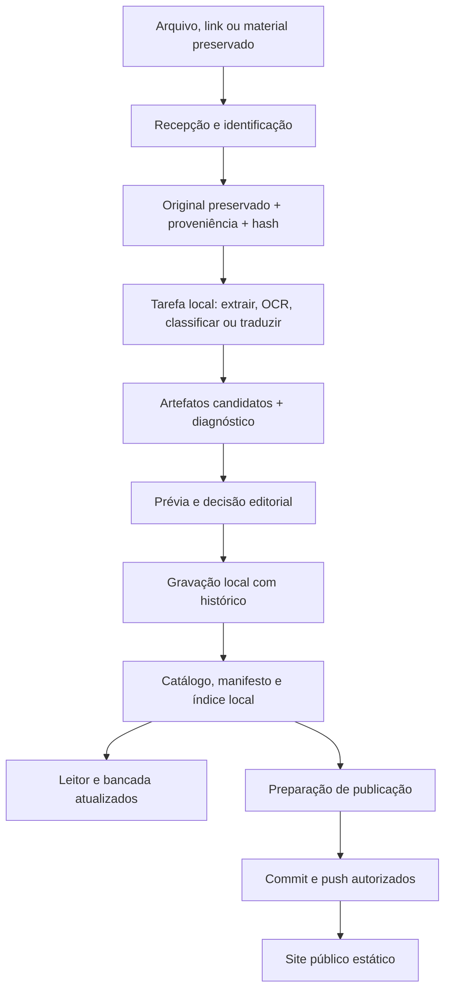

# Plano de incorporação das ferramentas de pesquisa

19/10/2026 — proposta baseada no levantamento dos pacotes importados e no código atual. Esta entrega é documentação e inventário; não instala ferramentas nem implementa suas operações.

## 1. Decisão central

Transformar o material do ShowTrials Discovery numa **oficina documental local integrada à interface Carmim**, compartilhando o catálogo do Documentos Soviéticos. O pesquisador deve conseguir receber uma fonte, conferir procedência, extrair/transcrever, corrigir, catalogar, traduzir e preparar a edição para leitura pública, sem movimentar arquivos manualmente entre vários projetos.

Não instalar todos os scripts antigos como comandos HTTP. Reaproveitar algoritmos e dados por adaptadores; manter o backend e o fluxo editorial existentes. Preservar originais, traduções, IDs, URLs, referências e histórico. Salvar continua sendo local; publicação é uma etapa separada.

Evidências e caminhos: [levantamento detalhado](../pesquisa/ferramentas-importadas/LEVANTAMENTO.md), [inventário de 291 arquivos técnicos](../pesquisa/ferramentas-importadas/inventario-scripts.csv) e [18 tabelas selecionadas](../pesquisa/ferramentas-importadas/artefatos-principais.csv).

## 2. O que reaproveitar e o que construir

| Frente | Reaproveitamento | Trabalho novo |
| --- | --- | --- |
| Catalogação | Classificação v4, auditorias, catálogos e proveniência. Parte já está no catálogo atual. | Assistente de sugestões explicadas, aplicação em lote com prévia e rastreio da decisão. |
| Padronização | Pessoas, variantes, organizações, funções e decisões legadas. | Autoridades com IDs estáveis, distinção candidato/confirmado e revisão reversível. |
| Glossário | G4.1 RU–EN, notas, estados e candidatos de exportação. | Camada portuguesa, editor, consulta contextual, versão do glossário e exportação específica por uso. |
| PDF e Word | Extração PDF simples; conversão `.doc` e comparação já produzidas neste projeto. | Banco de arquivos, visualizador, operações de página, referências de página e cotejo de extrações. |
| OCR | Fontes em PDF e necessidade identificada. | Motor, preparação de páginas, fila, diagnóstico e correção; não encontrado pronto no pacote. |
| Estrutura e alinhamento | Políticas D, perfis T, conversões Markdown e textos paralelos. | Unidades estáveis, mapeamento de revisões, alinhamento revisável e memória de tradução. |
| Tradução | Glossário, perfis e planejamento de lotes; importação/correção já existem. | Adaptador de tradução, orçamento, cache, retomada e revisão dos resultados. |
| Descoberta e redundância | Descoberta multi-fonte, cache, cotas arquivísticas, kits e comparação local. | Fila integrada, adaptadores atualizados, pontuação com evidências e incorporação assistida. |
| Pesquisa e publicação | Matrizes, perfis de processos e dossiês; leitor/bancada/Carmim aprovados. | Pessoas/episódios vinculados a passagens, índices públicos e preparação de publicação. |

Há 125 scripts idênticos nas duas cópias principais do Discovery. Importar uma linhagem com proveniência, não duas ferramentas para cada arquivo. O histórico e as políticas do projeto anterior informam este plano; não substituem a arquitetura atual, que já possui SQLite e tradução/importação operacional.

## 3. Experiência no site

### Site público

Manter a home de portal, coleções, busca, leitor multilíngue e apresentação editorial. Acrescentar progressivamente fac-símiles disponibilizados, glossário aprovado, pessoas, episódios e referências de passagem. Não mostrar filas internas, mensagens técnicas de OCR ou candidatos ainda não revisados como fatos do catálogo público.

O GitHub Pages continuará recebendo projeções estáticas de leitura. OCR, coleta e tradução executam localmente; os resultados selecionados podem ser publicados depois, pelo fluxo autorizado de commit/push. O plano não pressupõe backend público, login ou contas de leitores.

### Bancada de pesquisa

Conservar abas reais de documentos e um conteúdo principal amplo. Os instrumentos acompanham o documento ativo:

- **Fonte e PDF:** fac-símile/página ou arquivo de origem ao lado da transcrição.
- **Markdown:** texto e prévia, com o fluxo de revisão já existente.
- **Glossário:** termos da passagem, variantes, preferências e justificativas.
- **Pessoas e episódios:** ocorrências e vínculos documentados, com candidatos claramente separados.
- **Tradução:** preparar versão/lote, conferir unidades e revisar resultados.
- **Notas e referências:** notas privadas, citação da edição e ligação à página/trecho.

Não exibir todos os instrumentos vazios em todos os documentos. Por exemplo, PDF aparece quando há uma fonte associada; OCR é uma operação local disponível quando o motor estiver configurado. No celular, os painéis são empilhados ou abertos sob demanda.

### Área editorial local

Organizar as funções por tarefa, preservando os acessos atuais:

1. **Acervo:** catálogo, coleções e cadastros.
2. **Receber e preparar:** arquivos, links, lotes e resultados candidatos.
3. **Vocabulários e autoridades:** tipos, nomes, instituições e glossário.
4. **Processamentos:** fila, andamento, logs, retomada e falhas.
5. **Revisão:** pendências por documento/edição/página/passagem.
6. **Histórico e publicação:** recuperar alterações, preparar cópias e conferir o conjunto a publicar.

Abrir a ferramenta a partir do documento deve manter documento, idioma, página/passagem e retorno à leitura, sem uma segunda seleção desnecessária.

## 4. Arquitetura de processamento

**Concluir uma tarefa não publica seu resultado.** Extrair texto, sugerir um nome ou terminar uma tradução gera um candidato. Só a confirmação editorial altera a edição/catalogação oficial.

### Fila pequena, durável e local

Começar com execução de um trabalho pesado por vez, com uma fila SQLite própria e um worker separado do atendimento HTTP. Não introduzir Redis, Celery ou uma infraestrutura de serviços antes de existir necessidade comprovada.

Registrar: ID, tipo de tarefa, entradas e hashes, receita/versão, parâmetros, estado, progresso por item/página, artefatos, erro e tentativas. Estados propostos: `queued`, `running`, `completed`, `failed`, `cancelled`, `interrupted`. Ao reiniciar, identificar tarefas interrompidas e oferecer retomada; não repetir indiscriminadamente chamadas pagas ou gravações.

A chave de reaproveitamento inclui entrada, operação, versão da receita/motor, parâmetros e, quando aplicável, idioma, provedor/modelo e versão do glossário. Hash apenas do texto não basta para reutilizar qualquer resultado.

O trabalho pesado não mantém o bloqueio do catálogo ocupado. Lê um snapshot, produz artefatos na área de trabalho e só pede uma transação editorial curta ao aplicar o resultado. Se a versão mudou enquanto o trabalho rodava, exigir reconferência. O leitor deve continuar utilizável durante OCR/coleta.

### Separar persistência de índices descartáveis

| Camada proposta | Conteúdo | Regra |
| --- | --- | --- |
| `data/catalog/` e `originais/` atuais | Acervo editorial confirmado. | Preservar; evoluir esquema explicitamente, com compatibilidade. |
| `data/research/` — registros aprovados | Autoridades, glossário, referências e vínculos selecionados. | Dados versionados; gravação com prévia/histórico. Não guardar conhecimento apenas no índice. |
| `.local/research/jobs.sqlite3` | Fila operacional e retomada. | Persistente; não reconstruir nem apagar junto ao índice de busca. |
| `.local/research/` — candidatos/artefatos | Extrações, OCR, lotes e diagnósticos. | Não entram automaticamente no manifesto público. |
| `fontes/` e banco de arquivos a consolidar | HTML/PDF/DOC/imagens preservados e manifestos de aquisição. | Originais imutáveis; política explícita de backup e do que entra no Git. Sem mover os materiais atuais nesta entrega. |
| SQLite de busca atual | Projeção pesquisável de textos e metadados. | Derivado e reconstruível. Não usar como única cópia de notas, jobs ou autoridades. |
| Histórico editorial existente | Versões anteriores e operações recuperáveis. | Preservar formato legado e incluir novos tipos de entidade por evolução controlada. |

O primeiro marco deve incluir cópia recuperável da nova persistência, pois `.local/` não é protegido pelo Git. Exportar um pacote com manifesto e instruções de restauração, sem confundir isso com publicação de arquivos privados.

### Adaptadores e dependências

Cada ferramenta declara entradas aceitas, dependências, parâmetros limitados e saídas. O servidor não oferece execução de comando arbitrário, seleção irrestrita de caminhos ou importação direta dos scripts históricos que gravam arquivos ao carregar o módulo.

O núcleo atual continua funcionando sem OCR ou pacotes de conversão instalados. Uma tela de capacidades informa o que está disponível e o que falta. Dependências de pesquisa ficam separadas, com versões fixadas na entrega correspondente. A instalação de uma ferramenta não pode quebrar a leitura/editoria básica.

Manter as proteções locais atuais de origem, token, revisão e caminhos de escrita. Credenciais de provedores permanecem no backend; não em JavaScript público ou logs. Serviços pagos só executam com provedor e orçamento explicitamente configurados pelo responsável.

## 5. Entregas implementáveis

As complexidades abaixo são relativas, não estimativas de dias. Cada entrega termina em uma operação utilizável e um roteiro manual; não exige terminar toda a plataforma.

| ID | Entrega | Complexidade | Depende de | Resultado verificável |
| --- | --- | --- | --- | --- |
| F01 | Oficina local: arquivos, tarefas e candidatos | Média/alta | Backend/editoria atuais | Receber uma fonte, associar ao documento, processar diagnóstico em fila, reiniciar e retomar, conferir candidato sem alterar o acervo. |
| F02 | Catalogação assistida, nomes e glossário | Média | F01 para importações em lote | Conferir importação do legado, revisar uma variante/termo, ver sugestões no cadastro e consultar o glossário na bancada. |
| F03 | PDF/Word e fac-símile | Média/alta | F01 | Abrir fonte, escolher páginas, extrair texto, comparar com a página e encaminhar candidato ao editor. |
| F04 | OCR e correção por página | Alta | F01 + F03 | Reconhecer páginas selecionadas, rever erro/ordem de leitura, corrigir e promover uma transcrição candidata. |
| F05 | Passagens estáveis e alinhamento revisável | Alta | F01; dados de F02 ajudam | Identificar uma fala/pergunta/resposta ou anexo, vincular versões e detectar vínculo desatualizado após edição. |
| F06 | Oficina de tradução com memória e lotes | Alta | F01 + F02 + F05 | Preparar lote, aplicar glossário, executar ou exportar, retomar falhas, revisar diferenças e importar pelo fluxo existente. |
| F07 | Descoberta, coleta e comparação de fontes | Média/alta | F01 + F03; F02 melhora identificação | Registrar achado/citação, coletar fonte permitida, comparar com o acervo e incorporar sem duplicação automática. |
| F08 | Pessoas, episódios e pesquisa transversal | Alta | F02 + F05; F07 pode ampliar fontes | Navegar entre pessoa, episódio e documentos com passagem/atribuição, sem transformar alegação em fato. |
| F09 | Preparação de publicação e projeções públicas | Média/alta | F01; publicar apenas módulos já consolidados | Conferir alterações, incorporar eventos editoriais, preparar índices e manifestos públicos; publicação continua separada e autorizada. |

### F01 — Oficina local e fila

**Implementar:** cadastro de fonte/arquivo com MIME, tamanho, hash e proveniência; associação a documento existente sem alterar a URL; recepção em área de trabalho; fila durável com progresso, cancelamento e retomada; registro de receita e saídas; painel de capacidades; backup/exportação da persistência nova.

Primeira tarefa concreta: diagnóstico de um Markdown já existente — estrutura, identificação e divergências — usando/adaptando `backend/translations.py`. Isso verifica o fluxo completo antes de introduzir OCR e serviços pagos. A entrada também pode ser um arquivo binário preservado, ainda sem conversão.

**Reutilizar:** hashes e caminhos seguros de `backend/catalog.py`; limites e prévia da editoria; manifestos dos coletores existentes.

**Aceite manual:** abrir um arquivo; associá-lo; executar diagnóstico; navegar pelo leitor durante a tarefa; reiniciar e recuperar o estado; aplicar apenas após confirmação; conferir recuperação. A fonte permanece intacta.

### F02 — Assistente de catálogo, autoridades e glossário

Dividir internamente em três passos curtos: sugestões de cadastro; pessoas/variantes; glossário multilíngue.

**Implementar:** entidades com IDs, rótulos RU/PT/EN quando existentes, variantes, origem, regra e decisão editorial. Importar os 892 termos e demais tabelas como dados de legado, preservando seus estados sem certificação nova. Manter os campos portugueses ausentes até preenchimento/revisão. Oferecer amostra e comparação de cada lote antes de aplicar.

A classificação sugere tipo, organização em coleção e campos extraídos, mostrando a regra e a passagem que motivaram a sugestão. Um rótulo vindo de título, data do site ou propriedade de Word não preenche silenciosamente um campo histórico.

No glossário, separar identidade pessoal, transliteração, termo institucional e preferência contextual de tradução. Exibir opções/alternativas e notas, não fazer substituição global no texto. Um termo pode ter traduções diferentes conforme o contexto.

**Reutilizar:** classificação v4, tabelas E, decisões manuais e G4.1. O arquivo exportado para um provedor é uma projeção; não substitui o glossário editorial completo.

**Aceite manual:** revisar um nome homônimo/declinado; rejeitar uma fusão; preencher um termo português; ver sugestões no documento; desfazer pelo histórico. Uma decisão não reescreve o original nem retroativamente todas as traduções.

### F03 — Fontes PDF e Word

**Implementar:** visualização lado a lado de página e transcrição; seleção de intervalos; extração por página; derivados de divisão, reunião, rotação/reordenação de páginas; vínculo de artefato com documento e receita. Fonte original nunca é sobrescrita.

Preservar número físico da página no arquivo e rótulo/paginação impressa como campos distintos. Recortes indicam páginas e, quando necessário, região de origem. Extração de tabela e nota gera diagnóstico e pede conferência, não uma promessa de Markdown fiel automaticamente.

**Reutilizar:** extrator `pdfminer.six` simples importado e conversor antiword/DocBook atual. DOCX recebe adaptador próprio: o script legado de alinhamento não é importador universal.

**Ferramentas candidatas:** pdfminer.six para texto; pypdf para operações de páginas; PDF.js para visualização; antiword já usado para DOC. Confirmar dependências na entrega, sem obrigar o núcleo a carregá-las.

**Aceite manual:** PDF textual, PDF sem texto e documento Word com notas/tabela; conferir começo/fim, páginas e notas. Um volume pode produzir vários candidatos documentais sem perder o arquivo-fonte comum.

### F04 — OCR

**Implementar:** detecção por página da presença de texto, escolha de idioma/páginas, processamento em fila, artefato de texto por página e PDF pesquisável derivado, correção lado a lado, falhas por página e retomada. Registrar motor/versão, parâmetros e hashes.

**Candidatos:** Tesseract para imagens e OCRmyPDF para PDF pesquisável. OCR de texto impresso é a primeira meta. Manuscritos e diagramações difíceis ficam como casos específicos após avaliação; não prometer reconhecimento universal. Corrigir rotação/ordem de leitura e reconhecer texto são etapas distintas.

**Piloto:** selecionar páginas dos cinco PDFs auxiliares preservados, incluindo um volume inglês e o PDF russo RGASPI. Inspecionar visualmente antes de classificar qualidade ou supor que toda página é impressa. A inspeção não foi executada nesta entrega.

**Aceite manual:** corrigir um erro e ligá-lo à página; retomar um lote parcialmente falho sem repetir todas as páginas; comparar fonte e derivado; confirmar transcrição e recuperar sua versão anterior.

### F05 — Estrutura, passagens e alinhamento

**Implementar:** IDs estáveis de unidades documentais e seus vínculos com documento, edição, versão e fonte. Usar perfis por tipo: pergunta/resposta, troca em acareação, fala, carta, nota, anexo. A sugestão automática não decide sozinha a fronteira final.

Guardar hash do arquivo e do corpo tratado, receita de normalização, trecho literal e intervalo de referência. Definir explicitamente a unidade de contagem dos offsets entre Python/JavaScript; mudanças de cabeçalho ou normalização não podem deslocar correções silenciosamente.

Separar **passagem para leitura/citação** de **lote para tradução**. Uma unidade pode ser agrupada com contexto para processamento; limites antigos de 5.000 caracteres não definem a paginação, os parágrafos ou o leitor público.

Alinhamento deve admitir 1:1, 1:N, N:1 e ausência de correspondência. Notas exclusivas de um idioma não precisam forçar deslocamento do restante. Alterar a fonte marca vínculos afetados para reconferência; não reaponta uma citação ao parágrafo vizinho.

**Aceite manual:** interrogatório, sessão com falantes, comunicação com anexo e tradução com nota extra. Editar/inserir um parágrafo e conferir que referências permanecem corretas ou explicitamente pendentes. Contagens iguais não confirmam alinhamento.

### F06 — Oficina de tradução

**Implementar:** escolher documento, versão-fonte e idioma-alvo; glossário por versão; preparar unidades; aproveitar memória somente de correspondências confirmadas; exportar pacote para tradução externa ou executar provedor configurado; fila retomável com teto de custo; revisão e importação existente.

O pacote externo deve levar IDs/unidades e um manifesto, permitindo reimportar Markdown sem depender do nome do arquivo. Resultados são rascunhos, com origem, data, receita/provedor e revisão registrados. Nunca promover automaticamente a “tradução revisada”. Preservar versões humanas existentes e mostrar diferenças antes de substituí-las.

A chave de cache inclui texto/contexto, par de idiomas, receita, glossário e provedor/modelo. Retomar não deve repetir unidades concluídas ou cobrança já identificada; chamadas de resultado incerto ficam para reconciliação. Não prometer execução exatamente uma vez de APIs externas sem suporte do provedor.

**Reutilizar:** perfis T como ponto de partida, glossário G, diagnóstico de estrutura e o histórico de importação/correção atuais. Preparar RU–PT e RU–EN diretamente quando suportado, sem introduzir tradução via inglês por padrão.

**Aceite manual:** documento curto, documento longo e falha parcial; comparar preservação de falas, notas, listas e tabelas; conferir limite de orçamento e retomada; revisar antes de salvar. Escolha de provedor, credenciais e orçamento é uma decisão própria desta entrega.

### F07 — Descoberta e deduplicação

**Implementar:** perfis de pesquisa por pessoa/episódio, busca por fonte, registro manual de referência bibliográfica, coleta permitida com cache e proveniência, retomada e comparação com o catálogo atual. Conservar URL original, final e captura Wayback, quando usada.

Separar achado, apenas citado, acesso necessário e arquivo adquirido. Um PDF só citado numa página não entra como fonte coletada. Reutilizar o trabalho Wayback já produzido, em vez de assumir que os conectores antigos continuam válidos.

Deduplicação combina ID externo, hash, cota suficientemente específica, título/data e sobreposição textual. Mostrar evidências e distinguir edição alternativa, trecho contido, sobreposição e documento independente. Não apagar nem fundir automaticamente. Usar IDs estáveis, não números de linha.

**Aceite manual:** uma fonte HTML, uma referência apenas bibliográfica, falha de acesso e reprodução já conhecida; um caso de sobreposição parcial não pode ser eliminado como duplicata integral.

### F08 — Pesquisa transversal

**Implementar juntos:** fichas de pessoas e episódios, filtros entre coleções, ocorrências por nome/variante, concordâncias com contexto e vínculos a passagens. Buscar listas utilizáveis antes de grafos e métricas.

Relações devem conservar documento/edição, passagem, autor da afirmação e natureza do vínculo. “Mencionado como agente por X” não se transforma em atributo biográfico “era agente”. Coocorrência não vira relação histórica. Notas editoriais permanecem distintas da voz da fonte.

O glossário e as variantes aprovadas alimentam a busca, mas as grafias literais permanecem consultáveis. Datas incertas e datas de publicação não viram cronologia histórica exata por conveniência do gráfico.

**Aceite manual:** acompanhar uma pessoa e um episódio em documentos de mais de uma coleção, inspecionar a passagem de apoio e perceber o que é afirmação da fonte ou associação editorial.

### F09 — Preparar publicação e ampliar busca pública

**Implementar:** conjunto de mudanças destinado à publicação, pendências e arquivos selecionados; eventos próprios de incorporação/revisão/publicação; projeções aprovadas de glossário/autoridades; busca pública por metadados/variantes e posterior avaliação de índice textual dividido em partes.

A home deve consumir eventos editoriais reais; substituir progressivamente a fotografia Git atual, sem inventar datas antigas de publicação. Não incluir candidatos privados, credenciais, notas pessoais ou fila operacional nas projeções públicas.

O conjunto pode ser conferido localmente antes de commit/push. Não automatizar publicação sem autorização separada. Backup e restauração já devem existir desde F01; esta entrega consolida documentação e integridade da versão pública.

**Aceite manual:** preparar uma alteração conhecida, conferir a prévia pública, verificar que um rascunho privado está ausente e que as URLs antigas continuam funcionando. Medir o custo de busca no celular na entrega correspondente, sem prometer paridade imediata com FTS5.

## 6. Ordem recomendada e limites de escopo

Começar por **F01**, usando o diagnóstico de Markdown como operação piloto. Depois fazer **F02 e F03**: dão retorno imediato ao catálogo e ao trabalho com fontes. F04 adiciona OCR quando o arquivo e a conferência por página já existem. F05 pode avançar sobre os textos atuais sem esperar OCR completo. F06 depende da organização e do controle de versões, não apenas de conectar uma API.

F07 pode ser antecipada se a prioridade de trabalho voltar a ser aquisição; não precisa aguardar a tradução do corpus. Pessoas e episódios têm importância equivalente em F08. F09 publica gradualmente apenas o que estiver consolidado, mantendo o site estático operacional durante todas as etapas.

Não entram como requisitos iniciais: RAG, embeddings, grafo completo, reconstrução automática de todos os parágrafos, OCR universal, publicação remota do backend ou migração integral para framework. Esses temas só avançam quando resolverem um problema real que as entregas anteriores não atendem.

## 7. Critérios comuns a toda entrega

- Uma operação que o responsável consiga usar e conferir manualmente no contexto de um documento real.
- Fontes preservadas, proveniência e versão de receita; nenhum texto oficial alterado sem prévia/confirmação.
- Histórico recuperável também para as novas entidades e decisões.
- Processo repetido não cria duplicação de resultado por engano; processo falho não se apresenta como concluído.
- Ausência de dependência opcional não impede iniciar o backend ou ler o acervo.
- Interface Carmim mantida, com instrumentos contextuais, teclado e uso móvel.
- Sem commit/push ou execução de testes pelo assistente enquanto não houver nova autorização; oferecer roteiro manual.

## 8. Pedido sugerido para a primeira entrega

> Implemente a F01 do plano de ferramentas de pesquisa: uma oficina local para receber e associar arquivos-fonte, com proveniência, originais preservados e tarefas duráveis. Comece pelo diagnóstico estrutural de Markdown como tarefa piloto, com progresso, interrupção, retomada e resultados candidatos separados do acervo. Integre à área editorial e à bancada Carmim. Reutilize prévia, histórico, proteção de versões e catálogo existentes; inclua exportação recuperável dos novos dados locais. Não implemente OCR, tradução por API ou publicação automática nesta entrega. Preserve textos, traduções e URLs, registre as decisões e explique a validação manual. Não execute testes, não faça commit nem push. Pode resolver escolhas técnicas reversíveis sem me consultar.

## Registro desta análise

Arquivos gerados: este plano, levantamento detalhado e inventários em `docs/pesquisa/ferramentas-importadas/`. Não houve alteração na aplicação, no catálogo, nas fontes ou nas traduções nesta tarefa. Não foram executados scripts importados, testes, coleta, conversão, OCR, tradução ou instalações. Foram lidos arquivos, calculados hashes de materiais técnicos e conferidas tabelas para o inventário; documentação oficial externa foi consultada para as ferramentas candidatas, com links no levantamento. Sem commit ou push.

## Atualização — 20/10/2026

Projetos/versões privadas, recepção e manipulação PDF, OCR rus/eng/por, revisão durável por página e consulta de fac-símiles no estudo já foram entregues. Consulte [as entregas verificáveis](pdf-ocr/ENTREGA-04-FACSIMILES.md). O quadro acima conserva o planejamento de origem; as próximas frentes são alinhamento, incorporação editorial e publicação estática selecionada.
